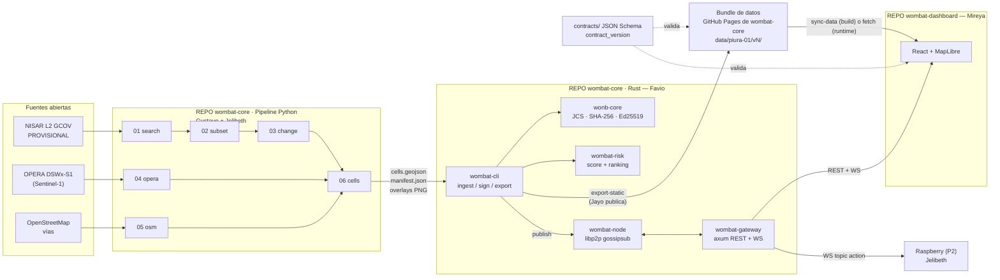
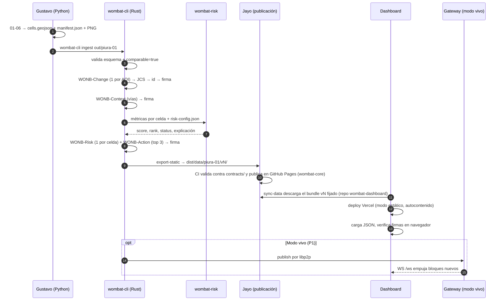
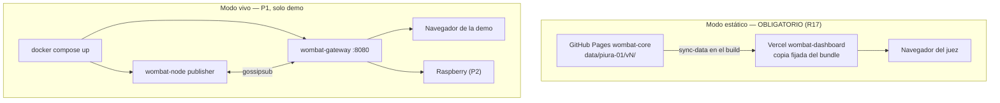
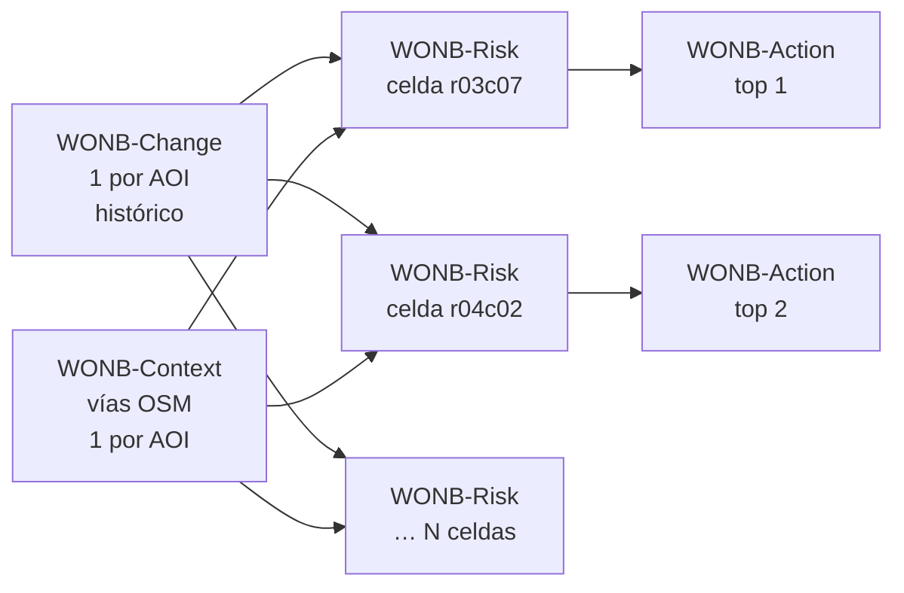
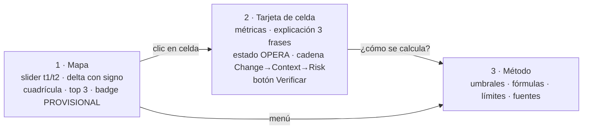
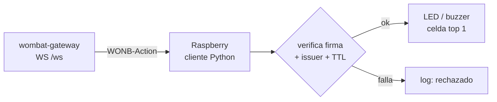
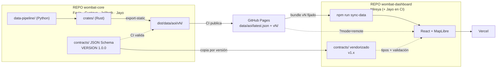
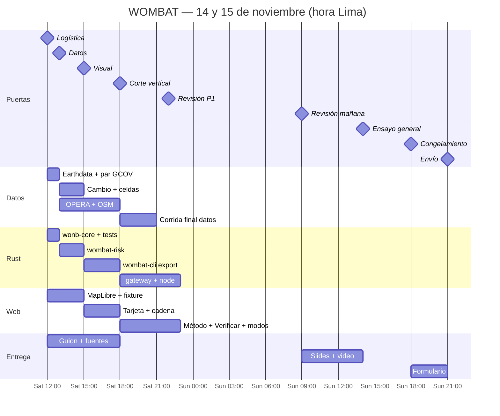

# WOMBAT — Plan Maestro

**Proyecto:** WOMBAT — El Niño Evidence Mesh
**Evento:** NASA International Space Apps Challenge 2026 — reto *Dancing with the SARs*
**Fase:** local (14–15 nov 2026) → global (desde el 16 nov)
**Versión del documento:** 1.2 — sábado 14 nov, 12:20 (Lima) — *cambio: arranque inmediato por persona; repositorio core confirmado*
**Dueño del documento:** Alex (coordinación). Cualquier cambio a una regla requiere acuerdo de Alex + dueño del componente.

> Este documento es la **fuente única de verdad**. Si algo en el chat, en un md anterior o en la memoria de alguien contradice este documento, gana este documento. Los md anteriores (versión Venezuela/GUNW, respuestas a revisiones) quedan **archivados**.

---

## 0. Inicio de ejecución — ahora

### 0.1 Contexto confirmado

| Hecho | Estado |
|---|---|
| Repositorio core | Confirmado: `https://github.com/Favio-coder/Wombat-core`. La rama objetivo es `main`. |
| Integración Git | `clean-wombat` se integra a `main`; si Git pide historias no relacionadas, Favio usa el merge explícito con `--allow-unrelated-histories`, resuelve conflictos y hace `push origin main`. |
| CI | Existe `ci.yml`. La ejecución anterior no llegó a correr por bloqueo de facturación de GitHub; después de desbloquearla se debe usar **Actions → Re-run all jobs**. No cambiar el workflow para “arreglar” una falla de facturación. |
| Dashboard | Aún es repositorio/proyecto separado por crear o confirmar por Mireya. |
| Earthdata / AOI / hardware / horas / evaluación local | No confirmados; no se inventan. Tienen dueño y puerta abajo. |

### 0.2 Qué hacemos en los próximos 30 minutos

Cada persona abre una rama corta, entrega evidencia y trabaja contra fixtures si aún no tiene datos reales. Nadie espera una tarea ajena para empezar.

| Persona | Lee primero | Arranca ahora | Primera evidencia esperada |
|---|---|---|---|
| **Favio** | §§ 7.3–8.4, R14–R16 | Confirmar `main`, reejecutar CI y dejar compilando `wonb-core` + `wombat-risk`. | URL de Actions verde o log local de `cargo test`. |
| **Gustavo** | §§ 6.1–6.5, R6–R13 | Earthdata: buscar dos GCOV PROVISIONAL comparables y abrir uno en Python/QGIS. | `candidates.json` + captura de un granule. |
| **Jayo** | §§ 7.3, 7.9, 12.5 | Crear/validar fixture de 12 celdas y estabilizar CI del core. | Commit con `risk-config.json`, fixture y CI ejecutado. |
| **Mireya** | §§ 7.8–7.9, 10 | Crear `wombat-dashboard`; mapa con fixture estático, sin esperar NISAR. | Captura de cuadrícula y top 3 local. |
| **Jelibeth** | §§ 6.6–6.8, 11 | Confirmar kit físico; si no bloquea, obtiene OSM y busca OPERA. | Foto del kit o mensaje “edge fuera”; `roads.geojson`/lista OPERA. |
| **Ximena** | §§ 1–2, 17 | Confirmar formato de jurado local y armar guion/slides con placeholders. | Respuesta del organizador + borrador de 7 slides. |
| **Alex** | §§ 13–15 | Fijar documento, pedir reporte de tres líneas y aplicar puertas. | Semáforo actualizado. |

### 0.3 Regla de avance

```text
Hecho = commit, URL, captura, archivo reproducible o deploy.
“Estoy investigando” = en curso.
“Ya casi” = no cuenta como avance.
```

### 0.4 Formato único de reporte al grupo

```text
[HH:MM] Nombre — componente
Hecho: enlace / commit / captura
Siguiente: entrega concreta para la siguiente puerta
Bloqueo: no | sí: qué necesito y de quién
```

---

## Índice

0. [Inicio de ejecución](#0-inicio-de-ejecución--ahora)
1. [Visión](#1-visión)
2. [Cómo ganamos](#2-cómo-ganamos)
3. [El core y las prioridades](#3-el-core-y-las-prioridades)
4. [Reglas que no se rompen](#4-reglas-que-no-se-rompen)
5. [Arquitectura — vista general](#5-arquitectura--vista-general)
6. [Datos — pipeline científico](#6-datos--pipeline-científico)
7. [Contratos de datos](#7-contratos-de-datos)
8. [Core Rust](#8-core-rust)
9. [Gateway — API](#9-gateway--api)
10. [Dashboard](#10-dashboard)
11. [Edge — Raspberry (P2)](#11-edge--raspberry-p2)
12. [Repositorio, ramas y CI](#12-repositorio-ramas-y-ci)
13. [Cronograma y puertas](#13-cronograma-y-puertas)
14. [Equipo: roles y primeras tareas](#14-equipo-roles-y-primeras-tareas)
15. [Revisión de avance](#15-revisión-de-avance)
16. [Riesgos y planes B](#16-riesgos-y-planes-b)
17. [Entrega y pitch](#17-entrega-y-pitch)
18. [Registro de decisiones](#18-registro-de-decisiones)
19. [Pendientes abiertos](#19-pendientes-abiertos)
20. [Glosario](#20-glosario)
21. [Fuentes](#21-fuentes)

---

## 1. Visión

### 1.1 Frase

> **When El Niño changes the coast, WOMBAT makes the evidence ready for preparation.**
> *From NISAR observations to auditable preparation decisions.*

### 1.2 Qué es

WOMBAT convierte observaciones radar de **NISAR** en una **recomendación verificable** sobre **qué zona de 1 km × 1 km verificar primero** durante la temporada de lluvias de El Niño Costero en Piura.

Cada recomendación lleva su evidencia:

- **qué cambió** (retrodispersión NISAR GCOV, con signo),
- **qué tan confiable es la señal** (máscara, looks, comparabilidad de escenas),
- **si una fuente independiente lo respalda** (OPERA DSWx-S1, agua superficial),
- **qué está expuesto** (vías de OpenStreetMap),
- **quién lo firmó y con qué método** (bloque WONB firmado con Ed25519).

### 1.3 Qué NO es

| No es | Por qué |
|---|---|
| Un predictor de inundaciones | Mide cambio observado, no pronostica. |
| Un sistema de alerta inmediata | NISAR tiene ciclo de 12 días y latencia nominal de 36–72 h. |
| Una validación científica | Los umbrales (±3 dB, 20 %, pesos) son demostrativos y visibles. |
| Una red P2P "porque sí" | P2P y edge son diferencial técnico, no el producto. |

### 1.4 Usuario y decisión (únicos)

| | |
|---|---|
| **Usuario** | Analista de gestión del riesgo del Gobierno Regional de Piura. |
| **Decisión** | Qué celda de 1 km priorizar para inspección de campo o monitoreo adicional durante la preparación ante lluvias de El Niño. |
| **Momento** | Días después de cada pasada NISAR (preparación), no en la emergencia. |

### 1.5 Contexto real

- ENFEN mantiene la alerta de El Niño Costero con magnitud extraordinaria prevista hasta febrero de 2027 y lluvias sobre lo normal desde noviembre.
- INDECI registró lluvias intensas en la provincia de Piura el **20 de octubre de 2026** (aniegos, vías y viviendas afectadas) y nuevos reportes a inicios de noviembre.

---

## 2. Cómo ganamos

### 2.1 Lo que tienen en común los ganadores recientes (2025)

1. Una **pregunta humana simple** ("¿dónde reviso primero?").
2. **Datos NASA accesibles y bien usados**, mostrados en la primera pantalla.
3. Una **salida accionable** (un ranking, una tarjeta, una decisión).
4. **Anclaje local** (QUEÑARIS, Perú, ganó Local Impact).
5. Ninguno ganó por ser una capa de protocolo o infraestructura.

**Consecuencia para nosotros:** la primera pantalla es el **cambio NISAR real sobre Piura**. WONB aparece en la segunda pantalla como "por qué puedes confiar en esto".

### 2.2 Criterios de evaluación → qué los cubre

| Criterio | Qué lo demuestra en WOMBAT | Dónde se ve |
|---|---|---|
| **Impacto** | Ranking de celdas con vía expuesta para un usuario real (GORE Piura). | Pantalla Mapa, top 3. |
| **Creatividad** | Evidencia firmada y verificable por cualquiera en el navegador. | Botón "Verificar". |
| **Validez** | Escenas comparables, quality gate, contraste OPERA, límites declarados. | Pantalla Método. |
| **Relevancia** | Responde al reto: app interactiva de cambio de superficie con NISAR. | Slider antes/después. |
| **Presentación** | 30 s de video + 7 diapositivas + link que funciona solo. | Entrega. |

### 2.3 Premios objetivo

- **Best Use of Data** (uso correcto de NISAR + OPERA + OSM).
- **Local Impact** (caso Piura / El Niño real).

### 2.4 Cómo perdemos (anti-patrones)

- Llegar al domingo con P2P, firmas y Raspberry funcionando pero **datos simulados**.
- Un link de Vercel que **no funciona sin backend** cuando lo abre un juez global días después.
- Decir "detectamos inundación" o "alerta a tiempo".
- Mezclar productos BETA y PROVISIONAL en el comparador.

---

## 3. El core y las prioridades

### 3.1 El core en una línea

```text
NISAR GCOV real → cambio con signo → contraste OPERA → celdas 1 km rankeadas por vía expuesta → tarjeta de evidencia verificable
```

### 3.2 Prioridades

| Nivel | Contenido | Si falta |
|---|---|---|
| **P0** | Par GCOV comparable real · celdas con métricas · ranking · dashboard **estático** en Vercel · README · video 30 s · 7 diapositivas · formulario enviado | No hay proyecto. |
| **P1** | Contraste OPERA (`unavailable` es respuesta válida) · bloques WONB firmados · botón Verificar en navegador · modo vivo por WebSocket | El proyecto se debilita. |
| **P2** | Malla libp2p multi-nodo · Raspberry/ESP32 · Chongos Bajo | No pasa nada. |

**Regla de prioridad:** nadie trabaja en P2 si hay un P0 en rojo. Nadie trabaja en P1 si hay un P0 sin dueño.

---

## 4. Reglas que no se rompen

Cada regla tiene un código. En los PR y en el chat se cita por código ("rompe R7").

### 4.1 Producto y narrativa

| Código | Regla |
|---|---|
| **R1** | La primera pantalla muestra **dato NISAR real**. Si no hay dato real, la pantalla lo dice con un rótulo `SIMULATED DATA` visible. |
| **R2** | Nunca decir "predicción", "alerta inmediata", "inundación confirmada" ni "llega a tiempo". Decimos "preparación", "cambio observado", "verificar primero". |
| **R3** | Todo umbral, peso o fórmula que afecte el ranking es **visible** en la pantalla Método y vive en `config/risk-config.json`. |
| **R4** | OPERA DSWx-S1 se declara siempre como **producto NASA derivado de Sentinel-1**, no de NISAR. |
| **R5** | Un solo usuario (analista GORE Piura) y una sola decisión (qué celda verificar primero). |

### 4.2 Datos

| Código | Regla |
|---|---|
| **R6** | t1 y t2 deben compartir **frame, dirección de órbita, modo, frecuencia, polarización y madurez**. Si uno falla, `comparable: false` y no se procesa. |
| **R7** | Nunca mezclar BETA, PROVISIONAL y VALIDATED en el mismo comparador. |
| **R8** | El cambio se guarda **con signo** (`delta_db`). `abs()` solo para estadísticas auxiliares, nunca como única señal. |
| **R9** | t1 y t2 se visualizan con **el mismo estiramiento de color** (mismos dB mínimo/máximo). Un estiramiento distinto fabrica cambios falsos. |
| **R10** | Cálculos en **UTM 17S (EPSG:32717)**. Solo los PNG para el mapa se reproyectan a **EPSG:4326**. |
| **R11** | No se asume el significado de un valor de máscara GCOV ni de una clase OPERA de memoria: se lee la especificación del producto y se cita en el código. |
| **R12** | Toda fuente externa queda registrada en `manifest.json` (ID de granule, fecha, URL, fecha de descarga). OSM lleva atribución "© OpenStreetMap contributors". |
| **R13** | El AOI evita **arrozales activos y núcleo urbano**, o los enmascara y lo declara. El riego por inundación y la ciudad producen señales que parecen cambio. |

### 4.3 Arquitectura

| Código | Regla |
|---|---|
| **R14** | **Python no firma.** Python produce evidencia sin firmar (`cells.geojson`, `manifest.json`). Solo Rust canonicaliza, calcula `id` y firma. |
| **R15** | **El ranking vive solo en Rust** (`wombat-risk`) y lee `risk-config.json`. Ningún otro componente recalcula el score. |
| **R16** | En el **payload firmado no hay floats**: fracciones en puntos básicos (0–10000), distancias en metros enteros, dB en centésimas enteras. Evita que Rust y JavaScript serialicen distinto y falle la verificación. |
| **R17** | El dashboard **funciona sin backend** (modo estático). El modo vivo es un plus. |
| **R18** | El navegador nunca habla libp2p. Habla con el gateway (REST/WS) o lee JSON estáticos. |
| **R19** | Las **claves privadas nunca entran al repo**. Van en `.env` local o en secretos de GitHub. Solo las públicas van en `trusted-issuers.json`. |
| **R20** | Los contratos de la sección 7 solo cambian con un PR en `wombat-core` que actualice: el JSON Schema en `contracts/`, el fixture y `contract_version`. Cambiar un campo "en caliente" está prohibido. |
| **R26** | **Dos repositorios.** `wombat-core` (datos + Rust) y `wombat-dashboard` (web). El dashboard **nunca importa código** del core: solo consume el **bundle de datos publicado** y los **JSON Schema** del contrato. |
| **R27** | El contrato tiene `contract_version` semver. Cambio que rompe → sube la versión mayor y se avisa en el grupo **antes** del merge. El dashboard declara qué versión mayor acepta y rechaza con mensaje claro una incompatible. |
| **R28** | El bundle publicado es **inmutable por versión**: `data/<aoi_id>/<bundle_version>/`. Se publica una versión nueva; nunca se sobrescribe una existente. `latest.json` apunta a la vigente. |

### 4.4 Proceso

| Código | Regla |
|---|---|
| **R21** | Avance = evidencia: commit, link, captura, manifiesto o deploy. "Ya casi" no es avance. |
| **R22** | Si una puerta falla, se aplica el plan B de inmediato. No se renegocia la puerta. |
| **R23** | Ninguna tarea bloqueada más de **30 min** sin avisar en el grupo. |
| **R24** | Congelamiento: domingo **17:59**. Después solo se corrigen defectos. |
| **R25** | Envío: domingo **21:00**, no 23:59. |

---

## 5. Arquitectura — vista general

### 5.1 Contexto: cómo se relaciona todo



### 5.2 Flujo de una corrida completa



### 5.3 Despliegue: dos modos



### 5.4 Cadena de evidencia WONB



Cada flecha es un `id` en el campo `parents` del bloque hijo. Romper un padre invalida la cadena.

### 5.5 Responsabilidades por capa

| Capa | Hace | No hace | Dueño |
|---|---|---|---|
| Pipeline Python | Descargar, recortar, calcular cambio, contrastar, celdas, PNG | Firmar, rankear | Gustavo (+ Jelibeth) |
| `wonb-core` | Tipos, JCS, hash, firma, verificación, TTL | I/O de red | Favio |
| `wombat-risk` | Score y ranking deterministas | Leer rásteres | Favio |
| `wombat-cli` | Orquestar ingest → bloques → export/publish | Lógica de UI | Favio |
| `wombat-node` | Publicar/suscribir gossipsub | Guardar historia | Favio |
| `wombat-gateway` | Puente HTTP/WS, caché por tópico, verificación | Recalcular score (R15) | Favio |
| Publicación | Validar bundle contra `contracts/`, publicar en GitHub Pages, CI de ambos repos | Editar datos a mano | Jayo |
| Dashboard (repo aparte) | Mostrar, explicar, verificar firma; consumir cualquier bundle que cumpla el contrato | Recalcular score (R15); importar código del core (R26) | Mireya |
| Edge | Recibir Action, verificar firma, encender LED | Decidir | Jelibeth |
| Narrativa | Pitch, video, landing, formulario | Cambiar umbrales | Ximena |

---

## 6. Datos — pipeline científico

### 6.1 Fuentes

| Fuente | Producto | Uso | Resolución | Nota |
|---|---|---|---|---|
| NISAR | L2 GCOV, PROVISIONAL | Cambio de retrodispersión γ⁰ | 10/20 m (freq A) u 80 m (freq B) según adquisición | Declarar la del granule real; no prometer 10 m. |
| OPERA | DSWx-S1 | Contraste independiente: agua nueva | 30 m | Derivado de Sentinel-1 (R4). Cobertura casi global desde sep 2024. |
| OpenStreetMap | Vías (`highway=*`) | Exposición | vectorial | Atribución obligatoria (R12). |

Productos L-band públicos con calibración: observaciones desde el **17 jun 2026**. Antes es BETA (R7).

### 6.2 Etapas

| Script | Entrada | Salida | Criterio de hecho |
|---|---|---|---|
| `01_search.py` | bbox, ventana de fechas | `candidates.json` | Lista con granule, fecha, frame, órbita, modo, pols, madurez. |
| `02_subset.py` | 2 granules elegidos | `t1.tif`, `t2.tif` (γ⁰ lineal), `mask_t1/t2.tif`, `looks_t1/t2.tif`, `manifest.json` | `comparable: true` en manifest. |
| `03_change.py` | t1, t2, máscaras, looks | `delta_db.tif` (float32, NaN = inválido), `valid.tif` | Histograma de `delta_db` razonable, no todo 0 ni todo NaN. |
| `04_opera.py` | bbox, fechas t1/t2 | `water_t1.tif`, `water_t2.tif`, `water_new.tif` (malla 30 m) | Granules OPERA con desfase ≤ 6 días, o `unavailable`. |
| `05_osm.py` | bbox | `roads.geojson` (EPSG:32717) | Descargado **una vez**, con fecha. |
| `06_cells.py` | todo lo anterior | `cells.geojson`, `overlays/*.png`, `bounds.json` | Una fila por celda, sin NaN en el payload. |

### 6.3 Búsqueda (01)

- Ventana t1: última adquisición **antes del 20 oct 2026** del mismo frame.
- Ventana t2: primera adquisición **después** del mismo frame/modo.
- Herramientas: `earthaccess` / `asf_search` / Earthdata Search / ASF Vertex. Los nombres exactos de colección y parámetros se **verifican en la doc de ASF** antes de escribir el script (R11).
- Preferir subconjunto (Harmony / recorte) a descargar HDF5 completo.

### 6.4 Quality gate (03)

Un píxel entra al cálculo solo si **todo** se cumple:

```text
valid(p) =
    mask_t1(p) indica dato válido      (decodificado según spec del granule, R11)
  ∧ mask_t2(p) indica dato válido
  ∧ looks_t1(p) > 0 ∧ looks_t2(p) > 0
  ∧ γ⁰_t1(p), γ⁰_t2(p) finitos y > 0
  ∧ manifest.comparable == true      (R6)
```

Las rutas HDF5 (p. ej. `/science/LSAR/GCOV/grids/frequencyA/...`) se confirman con `h5ls -r` sobre el granule real antes de codificarlas.

### 6.5 Cambio con signo (03)

```text
delta_db(p) = 10 · log10( (γ⁰_t2(p) + ε) / (γ⁰_t1(p) + ε) ),   ε = 1e-10
decrease(p) = delta_db(p) ≤ −3.0 dB     # compatible con agua abierta (reflexión especular)
increase(p) = delta_db(p) ≥ +3.0 dB     # compatible con vegetación inundada (doble rebote)
changed(p)  = decrease(p) ∨ increase(p)
```

Lectura prudente: ninguna de las dos señales **es** inundación. Son compatibles con ella en algunos contextos.

### 6.6 Contraste OPERA (04 + 06)

```text
water_t(p)  = clase OPERA ∈ {agua abierta, vegetación inundada}   # códigos leídos de la spec (R11)
water_new(p)= water_t2(p) ∧ ¬water_t1(p) ∧ válido en ambas fechas

En malla común de 30 m (EPSG:32717):
changed_30(q) = fracción de píxeles NISAR cambiados dentro de q ≥ 0.5

overlap_ratio(celda) = |changed_30 ∩ water_new| / |changed_30|

opera_status =
  unavailable       si no hay OPERA con desfase ≤ 6 días en t1 o t2
  corroborated      si overlap_ratio ≥ 0.20
  not_corroborated  si overlap_ratio < 0.20
```

### 6.7 Exposición vial (05 + 06)

```text
change_zone = dilatación de changed(p) con radio 250 m
road_m_near_change(celda) = longitud (m) de vías OSM ∩ change_zone ∩ celda
road_m_total(celda)       = longitud (m) de vías OSM ∩ celda
```

### 6.8 Cuadrícula (06)

- 1 km × 1 km alineada a múltiplos de 1000 m en EPSG:32717.
- `cell_id = "<aoi>-rRRcCC"` (fila, columna desde la esquina noroeste del AOI).
- Celdas con `valid_fraction < 0.60` se marcan `insufficient_quality` y no entran al ranking.

### 6.9 Overlays para el mapa (06)

| Archivo | Contenido | Estiramiento |
|---|---|---|
| `t1.png`, `t2.png` | γ⁰ en dB, escala de grises | **El mismo** para ambos, p. ej. percentiles 2–98 calculados sobre t1 ∪ t2 (R9). |
| `delta.png` | `delta_db` en paleta divergente (azul = bajó, rojo = subió), transparente donde inválido | Fijo en ±6 dB. |
| `bounds.json` | 4 esquinas en EPSG:4326 en el orden que pide MapLibre (`[top-left, top-right, bottom-right, bottom-left]`) | — |

PNG reproyectados a EPSG:4326 antes de exportar (R10).

---

## 7. Contratos de datos

Los contratos son la frontera entre personas. Si un contrato cambia, cambia en un PR (R20).

### 7.1 `manifest.json` (Python → todos)

```json
{
  "aoi_id": "piura-01",
  "aoi_name": "Bajo Piura — planicie aluvial (provisional)",
  "crs_compute": "EPSG:32717",
  "bbox_wgs84": [-80.80, -5.35, -80.55, -5.10],
  "nisar": {
    "product": "NISAR_L2_GCOV",
    "maturity": "PROVISIONAL",
    "frame": "TODO",
    "orbit_direction": "ascending|descending",
    "mode": "TODO",
    "frequency": "A",
    "polarization": "HHHH",
    "pixel_spacing_m": 20,
    "t1": { "granule": "TODO", "datetime": "2026-10-XXTHH:MM:SSZ" },
    "t2": { "granule": "TODO", "datetime": "2026-10-XXTHH:MM:SSZ" },
    "comparable": true,
    "comparable_checks": {
      "same_frame": true, "same_orbit_direction": true, "same_mode": true,
      "same_frequency": true, "same_polarization": true, "same_maturity": true
    }
  },
  "opera": {
    "product": "OPERA_L3_DSWx-S1",
    "derived_from": "Sentinel-1",
    "t1": { "granules": ["TODO"], "gap_days": 2 },
    "t2": { "granules": ["TODO"], "gap_days": 4 },
    "status": "available|unavailable"
  },
  "osm": { "query": "highway=*", "retrieved_at": "2026-11-14T15:00:00Z", "attribution": "© OpenStreetMap contributors" },
  "pipeline": { "commit": "TODO", "risk_config_version": "risk-config/0.1" }
}
```

El `bbox_wgs84` es un ejemplo de forma, no el AOI final. El AOI final sale de la puerta de 13:00.

### 7.2 `cells.geojson` (Python → Rust)

Floats permitidos aquí (no se firma). Rust los convierte a enteros al construir el payload (R16).

```json
{
  "type": "FeatureCollection",
  "crs_note": "geometry en EPSG:4326 para el mapa; cálculos hechos en EPSG:32717",
  "features": [
    {
      "type": "Feature",
      "geometry": { "type": "Polygon", "coordinates": [[[-80.70,-5.20],[-80.691,-5.20],[-80.691,-5.209],[-80.70,-5.209],[-80.70,-5.20]]] },
      "properties": {
        "cell_id": "piura-01-r03c07",
        "valid_fraction": 0.92,
        "decrease_fraction": 0.18,
        "increase_fraction": 0.04,
        "changed_fraction": 0.22,
        "p90_abs_delta_db": 4.1,
        "opera_status": "corroborated",
        "opera_overlap_ratio": 0.31,
        "road_m_near_change": 2400,
        "road_m_total": 5100
      }
    }
  ]
}
```

| Campo | Tipo | Rango | Nulo |
|---|---|---|---|
| `cell_id` | string | patrón `<aoi>-rNNcNN` | no |
| `valid_fraction` | float | 0–1 | no |
| `decrease_fraction`, `increase_fraction`, `changed_fraction` | float | 0–1 | no |
| `p90_abs_delta_db` | float | ≥ 0 | sí si `valid_fraction`=0 |
| `opera_status` | enum | `corroborated`/`not_corroborated`/`unavailable` | no |
| `opera_overlap_ratio` | float | 0–1 | sí si `unavailable` |
| `road_m_near_change`, `road_m_total` | int | ≥ 0 | no |

### 7.3 `config/risk-config.json` (único lugar de umbrales, R3)

```json
{
  "version": "risk-config/0.1",
  "delta_db_threshold": 3.0,
  "quality_min_valid_fraction": 0.60,
  "change_saturation": 0.25,
  "opera_max_gap_days": 6,
  "corroboration_overlap_threshold": 0.20,
  "road_buffer_meters": 250,
  "weights": { "change": 0.45, "opera": 0.35, "road": 0.20 },
  "status_thresholds": { "review_high": 0.60, "review_medium": 0.35 },
  "top_n_actions": 3,
  "ttl_seconds": { "risk": 86400, "action": 3600 }
}
```

### 7.4 Sobre WONB v0.2 (Rust)

```json
{
  "wonb_version": "0.2",
  "id": "sha256:<hex>",
  "type": "change|context|risk|action",
  "topic": "wombat/pe/piura/piura-01/risk",
  "issued_at": "2026-11-14T20:00:00Z",
  "valid_until": "2026-11-15T20:00:00Z",
  "issuer": "ed25519:<pubkey hex>",
  "parents": ["sha256:<hex>", "sha256:<hex>"],
  "payload": {},
  "provenance": {
    "sources": [
      { "product": "NISAR_L2_GCOV", "granule": "…", "maturity": "PROVISIONAL" },
      { "product": "OPERA_L3_DSWx-S1", "derived_from": "Sentinel-1", "granule": "…" },
      { "product": "OpenStreetMap", "retrieved_at": "2026-11-14" }
    ],
    "method": "risk-config/0.1",
    "code_commit": "<git sha>"
  },
  "signature": "<ed25519 hex>"
}
```

**Cálculo de `id` y firma:**

```text
body       = sobre sin los campos "id" y "signature"
canonical  = JCS(body)                      # RFC 8785
id         = "sha256:" + hex(SHA-256(canonical))
signature  = hex(Ed25519_sign(sk, SHA-256(canonical)))   # se firman los 32 bytes del hash
```

**Verificación (Rust, gateway, navegador, edge):**

```text
1. recomputar canonical y hash → coincide con id         → hash_ok
2. Ed25519_verify(pk(issuer), hash, signature)            → signature_ok
3. issuer ∈ trusted-issuers.json con rol permitido        → issuer_trusted
4. valid_until == null  ∨  now < valid_until              → not_expired
5. cada parent existe y verifica                          → chain_ok
```

**TTL por tipo:**

| Tipo | `valid_until` |
|---|---|
| change | `null` (histórico) |
| context | `null` (histórico, fechado por `retrieved_at`) |
| risk | `issued_at + 24 h` |
| action | `issued_at + 1 h` |

### 7.5 Payloads (sin floats, R16)

**Change** (1 por AOI):

```json
{
  "aoi_id": "piura-01",
  "t1": "2026-10-XXT…Z", "t2": "2026-10-XXT…Z",
  "polarization": "HHHH", "frequency": "A", "pixel_spacing_m": 20,
  "delta_db_threshold_cdb": 300,
  "aoi_valid_bp": 8800,
  "aoi_decrease_bp": 1200, "aoi_increase_bp": 300,
  "overlay_sha256": { "t1.png": "…", "t2.png": "…", "delta.png": "…" },
  "cells_geojson_sha256": "…"
}
```

**Context** (1 por AOI):

```json
{ "aoi_id": "piura-01", "roads_total_m": 184000, "road_buffer_m": 250, "osm_retrieved_at": "2026-11-14", "roads_geojson_sha256": "…" }
```

**Risk** (1 por celda):

```json
{
  "cell_id": "piura-01-r03c07",
  "status": "review_high",
  "rank": 1,
  "score_bp": 7420,
  "components_bp": { "change": 8800, "opera": 3100, "road": 10000 },
  "metrics": {
    "valid_bp": 9200, "decrease_bp": 1800, "increase_bp": 400, "changed_bp": 2200,
    "p90_abs_delta_cdb": 410,
    "opera_status": "corroborated", "opera_overlap_bp": 3100,
    "road_m_near_change": 2400, "road_m_total": 5100
  },
  "explanation": [
    "18% of valid pixels decreased ≥3 dB; 4% increased ≥3 dB.",
    "OPERA DSWx-S1 (Sentinel-1) shows new water on 31% of changed area.",
    "2.4 km of road lie within 250 m of changed pixels."
  ]
}
```

**Action** (top N):

```json
{ "cell_id": "piura-01-r03c07", "rank": 1, "action": "field_verification_first", "audience": "GORE Piura risk analyst" }
```

### 7.6 Tópicos

```text
wombat/pe/piura/<aoi_id>/change
wombat/pe/piura/<aoi_id>/context
wombat/pe/piura/<aoi_id>/risk
wombat/pe/piura/<aoi_id>/action
```

### 7.7 `trusted-issuers.json`

```json
{
  "version": 1,
  "issuers": [
    { "issuer": "ed25519:<hex>", "name": "wombat-core-demo", "roles": ["change", "context", "risk", "action"] }
  ]
}
```

### 7.8 Bundle de datos publicado (la interfaz entre repos)

Lo genera `wombat-cli export-static` en `wombat-core` y lo publica CI en GitHub Pages:

```text
https://<owner>.github.io/wombat-core/data/<aoi_id>/latest.json      → {"bundle_version":"v3","path":"v3/"}
https://<owner>.github.io/wombat-core/data/<aoi_id>/<bundle_version>/
```

GitHub Pages sirve con CORS abierto, así que el dashboard también puede leerlo en tiempo de ejecución. Para la entrega, el dashboard copia una versión **fijada** del bundle en su build (10.3), así el link de Vercel no depende de que Pages esté arriba.

Contenido de cada versión:

```text
index.json                 # contract_version, bundle_version, aoi_id, generated_at, lista de archivos con sha256
manifest.json
cells.geojson
roads.geojson              # simplificado para el mapa
overlays/t1.png  t2.png  delta.png  bounds.json
wonb/change.json
wonb/context.json
wonb/risk/<cell_id>.json
wonb/action/<rank>.json
trusted-issuers.json
risk-config.json
```

Ejemplo de `index.json`:

```json
{
  "contract_version": "1.0.0",
  "bundle_version": "v3",
  "aoi_id": "piura-01",
  "generated_at": "2026-11-14T22:00:00Z",
  "core_commit": "<git sha de wombat-core>",
  "files": [
    { "path": "cells.geojson", "sha256": "…" },
    { "path": "wonb/change.json", "sha256": "…" }
  ]
}
```

### 7.9 Contratos como JSON Schema (`wombat-core/contracts/`)

```text
contracts/
├─ VERSION                       # 1.0.0
├─ manifest.schema.json
├─ cells.schema.json
├─ risk-config.schema.json
├─ wonb-envelope.schema.json
├─ wonb-payloads.schema.json     # change / context / risk / action
├─ bundle-index.schema.json
└─ fixtures/bundle/piura-demo/v0/   # bundle falso pero válido y FIRMADO
```

- `wombat-core` CI valida cada bundle contra estos esquemas antes de publicarlo.
- `wombat-dashboard` copia los esquemas de la versión que acepta (`contracts/` vendorizado, con el número de versión) y los usa para tipos TypeScript y validación en el cliente.
- El bundle fixture `piura-demo/v0` se publica **desde la primera hora**, para que Mireya trabaje sin esperar datos reales.

---

## 8. Core Rust

### 8.1 Crates

| Crate | Tipo | Dependencias principales | Responsabilidad |
|---|---|---|---|
| `wonb-core` | lib | `serde`, `serde_json`, `serde_jcs`, `sha2`, `ed25519-dalek`, `hex`, `thiserror`, `chrono` | `Envelope`, `BlockType`, `canonical()`, `compute_id()`, `sign()`, `verify()`, `is_expired()`. |
| `wombat-risk` | lib | `serde`, `wonb-core` | `RiskConfig`, `CellMetrics`, `score()`, `rank()`, `explain()`. Determinista. |
| `wombat-cli` | bin | `clap`, `anyhow`, `geojson`, todo lo anterior | `keygen`, `ingest`, `export-static`, `publish`, `verify`. |
| `wombat-node` | lib+bin | `libp2p` (gossipsub, noise, yamux, tcp, macros), `tokio` | Publicar/suscribir por tópico. |
| `wombat-gateway` | bin | `axum` (con ws), `tokio`, `tower-http` (cors), `wombat-node` | REST + WS + caché. |

**Versiones:** fijadas por `Cargo.lock` en el repo. Ojo: `cargo add` resolvió `ed25519-dalek 3.x`, `sha2 0.11`, `thiserror 2`. La API de `ed25519-dalek 3` puede diferir de ejemplos de 2.x; Favio decide la versión una vez y nadie la cambia.

### 8.2 Interfaces mínimas (`wonb-core`)

```rust
pub enum BlockType { Change, Context, Risk, Action }

pub struct Envelope {
    pub wonb_version: String,
    pub id: Option<String>,
    pub r#type: BlockType,
    pub topic: String,
    pub issued_at: DateTime<Utc>,
    pub valid_until: Option<DateTime<Utc>>,
    pub issuer: String,
    pub parents: Vec<String>,
    pub payload: serde_json::Value,
    pub provenance: Provenance,
    pub signature: Option<String>,
}

pub fn canonical_body(e: &Envelope) -> Result<Vec<u8>, WonbError>;   // sin id ni signature
pub fn seal(e: Envelope, sk: &SigningKey) -> Result<Envelope, WonbError>; // id + signature
pub fn verify(e: &Envelope, trusted: &TrustedIssuers, now: DateTime<Utc>) -> VerifyReport;

pub struct VerifyReport { pub hash_ok: bool, pub signature_ok: bool, pub issuer_trusted: bool, pub not_expired: bool }
```

### 8.3 `wombat-risk`

```text
para cada celda c:
  si c.valid_fraction < quality_min_valid_fraction → status = insufficient_quality; fuera del ranking
  change = min(c.changed_fraction / change_saturation, 1)
  opera  = c.opera_overlap_ratio  si opera_status ≠ unavailable  sino 0  (+ bandera en explicación)
  road   = c.road_m_near_change / max_c(road_m_near_change)    (0 si el máximo es 0)
  score  = w.change·change + w.opera·opera + w.road·road
  status = review_high si score ≥ 0.60 · review_medium si ≥ 0.35 · review_low si no
rank = orden por score desc; empates → mayor change; luego cell_id asc (determinista)
```

**Pruebas obligatorias:**

1. Mismo fixture → mismo ranking y mismos `id` en dos corridas.
2. Celda con `valid_fraction = 0.5` nunca aparece en el ranking.
3. `opera_status = unavailable` no rompe el cálculo y aparece en la explicación.
4. Cambiar un byte del payload → `hash_ok = false`.
5. Firma con clave no confiable → `issuer_trusted = false`.

### 8.4 `wombat-cli`

```bash
wombat-cli keygen --out .keys/demo.key                         # nunca al repo (R19)
wombat-cli ingest --in data-pipeline/out/piura-01 --config config/risk-config.json \
                  --key .keys/demo.key --out build/piura-01
wombat-cli export-static --in build/piura-01 --bundle-version v3 --out dist/data/piura-01/v3
wombat-cli verify --in dist/data/piura-01/v3 --trusted config/trusted-issuers.json
wombat-cli publish --in build/piura-01 --bootstrap /ip4/127.0.0.1/tcp/4001/p2p/<peer>
```

`ingest` falla con error claro si `manifest.comparable != true` (R6) o si `cells.geojson` no cumple el esquema.

### 8.5 Red libp2p (P1/P2)

- Transporte TCP + Noise + Yamux; GossipSub por tópico (7.6).
- GossipSub **no repite historia**: el gateway guarda el último bloque por tópico y lo sirve a quien se conecta tarde.
- Descubrimiento por **dirección bootstrap explícita**, no mDNS (las redes de hackathon suelen bloquearlo).

---

## 9. Gateway — API

Base: `http://<host>:8080`. CORS abierto solo al origen del dashboard.

| Método | Ruta | Respuesta | Notas |
|---|---|---|---|
| GET | `/api/health` | `{"status":"ok","peers":2,"blocks":57}` | — |
| GET | `/api/state/latest?topic=<t>` | `Envelope` | 404 si no hay bloque. |
| GET | `/api/blocks/:id` | `Envelope` | — |
| GET | `/api/verify/:id` | `VerifyReport + chain_ok` | — |
| GET | `/api/aoi/:aoi_id/ranking` | `[{cell_id, rank, status, score_bp}]` | Lee bloques Risk; **no recalcula** (R15). |
| WS | `/ws` | stream de `Envelope` | Al conectar, envía el último bloque de cada tópico. |
| POST | `/api/publish` | `202` | Solo desde `127.0.0.1`; verifica firma antes de aceptar. |

Al arrancar, el gateway puede **sembrar su caché** desde `build/<aoi_id>/` para que la demo no dependa de que la red esté arriba primero.

---

## 10. Dashboard

### 10.1 Stack

Vite + React + TypeScript + `maplibre-gl`. Mapa base con estilo abierto (p. ej. OpenFreeMap) o teselas OSM con atribución. Verificación en navegador con `@noble/ed25519` + `@noble/hashes` + `canonicalize` (RFC 8785).

### 10.2 Tres pantallas, no más



| Pantalla | Debe responder en < 10 s | Elementos obligatorios |
|---|---|---|
| Mapa | "¿Dónde cambió y qué reviso primero?" | Slider, leyenda azul/rojo, top 3 numerado, badge `NISAR PROVISIONAL`, fechas t1/t2, atribuciones. |
| Tarjeta | "¿Por qué esta celda?" | 3 frases, componentes del score, estado OPERA, hashes cortos, ✓/✗ de verificación. |
| Método | "¿Puedo confiar?" | `risk-config.json` renderizado, fórmulas de 6.5–6.7 y 8.3, sección "Lo que no afirmamos". |

### 10.3 Modos

```text
?mode=static  (por defecto)  → fetch ${VITE_DATA_BASE_URL}/<aoi_id>/<version>/index.json
                               por defecto VITE_DATA_BASE_URL=/data  (copia fijada en el build)
?mode=remote                  → mismo flujo contra GitHub Pages de wombat-core (último bundle)
?mode=live                    → GET /api/state/latest + WS /ws (VITE_GATEWAY_URL)
```

Configuración (`.env` del dashboard):

```text
VITE_DATA_BASE_URL=/data
VITE_REMOTE_DATA_BASE_URL=https://<owner>.github.io/wombat-core/data
VITE_AOI_ID=piura-01
VITE_BUNDLE_VERSION=v3          # fijada para la entrega
VITE_GATEWAY_URL=http://localhost:8080
VITE_ACCEPTED_CONTRACT_MAJOR=1
```

`npm run sync-data` descarga `VITE_BUNDLE_VERSION` desde `VITE_REMOTE_DATA_BASE_URL`, verifica los `sha256` de `index.json` y lo copia a `public/data/`. Vercel ejecuta `sync-data` antes de `build`.

Al cargar cualquier bundle, el dashboard comprueba `contract_version` (R27). Si el modo vivo o remoto falla, cae al estático fijado y lo indica con un aviso discreto.

**Reutilizable:** el dashboard no sabe de Piura. Cualquier AOI con un bundle que cumpla el contrato se muestra cambiando `VITE_AOI_ID` o `?aoi=`.

### 10.4 Botón Verificar

Ejecuta los pasos 1–5 de 7.4 en el navegador y muestra cada uno con ✓/✗. Antes de las 18:00 debe existir una **prueba cruzada**: el mismo bloque fixture verificado por `wombat-cli verify` y por el navegador. Si no coinciden, el botón llama a `/api/verify/:id` en modo vivo y en estático muestra el resultado precalculado por `wombat-cli verify` (marcado como tal).

---

## 11. Edge — Raspberry (P2)

**Entra solo si** Jelibeth confirma el kit completo a las 12:00 (foto) **y** P0 está en verde el domingo por la mañana.



| Decisión | Valor |
|---|---|
| Conexión | WebSocket al gateway (no libp2p en el Pi: compilar Rust en ARM durante la noche es riesgo innecesario). |
| Verificación | Python + PyNaCl: firma Ed25519 sobre el hash + issuer confiable + TTL. Recomputar el `id` con JCS en Python es opcional; si no se hace, se declara. |
| Reloj | Sin RTC el TTL falla: sincronizar hora (NTP por el hotspot) antes de la demo. |
| Red | Hotspot propio; IP del gateway fija en un `.env`. |
| Narrativa | Recibe **el mismo** Action del AOI de Piura. Rótulo: "secondary edge demonstration". |

Si no entra: el dashboard muestra un panel "Action delivered (simulated)" y el pitch dice **"edge-ready"**, nunca "desplegado en hardware".

---

## 12. Repositorios, ramas y CI

### 12.1 Dos repositorios desacoplados (R26)



| | `wombat-core` | `wombat-dashboard` |
|---|---|---|
| Contiene | pipeline Python, crates Rust, `config/`, `contracts/`, fixtures, `docker-compose.yml`, `edge/` | app React + MapLibre, `contracts/` vendorizado, script `sync-data` |
| Publica | bundle de datos en GitHub Pages (7.8) | sitio en Vercel |
| Depende de | nada del dashboard | **solo** del contrato y del bundle publicado (R26) |
| Dueño | Favio | Mireya |
| Despliegue | GitHub Actions → Pages | Vercel desde `main` |

**Qué se gana:** Mireya trabaja desde la primera hora con el bundle fixture; el core puede cambiar internamente sin romper la web mientras respete el contrato; el dashboard sirve para cualquier AOI o futuro proyecto que publique un bundle compatible.

### 12.2 Estructura de `wombat-core`

```text
wombat-core/
├─ README.md                 # qué es, cómo correr, fuentes, límites, uso de IA
├─ LICENSE                   # Apache-2.0
├─ config/
│  ├─ risk-config.json
│  └─ trusted-issuers.json
├─ contracts/                # JSON Schema + VERSION + bundle fixture (7.9)
├─ data-pipeline/
│  ├─ requirements.txt
│  ├─ 01_search.py … 06_cells.py
│  ├─ common/                # proyecciones, IO, decodificación de máscara
│  └─ out/<aoi_id>/          # ignorado en git
├─ crates/
│  ├─ wonb-core/  wombat-risk/  wombat-cli/  wombat-node/  wombat-gateway/
├─ fixtures/
│  ├─ cells.geojson          # falso pero válido; sirve para trabajar sin esperar datos
│  └─ manifest.json
├─ dist/data/<aoi_id>/<vN>/  # salida de export-static (lo publica CI; ignorado en git)
├─ edge/                     # P2
├─ docker-compose.yml        # node + gateway (modo vivo)
└─ .github/workflows/
   ├─ ci.yml                 # tests + validación de contrato
   └─ publish-data.yml       # dist/ → GitHub Pages (manual o por tag data-<aoi>-<vN>)
```

### 12.3 Estructura de `wombat-dashboard`

```text
wombat-dashboard/
├─ README.md                 # cómo apuntar a otro bundle; contrato aceptado
├─ LICENSE                   # Apache-2.0
├─ contracts/v1/             # copia de wombat-core/contracts (versión aceptada)
├─ scripts/sync-data.mjs     # descarga bundle fijado, verifica sha256, copia a public/data
├─ public/data/              # ignorado en git; lo llena sync-data en el build
├─ src/
│  ├─ data/                  # loaders: static | remote | live — una sola interfaz
│  ├─ verify/                # JCS + SHA-256 + Ed25519 en navegador
│  ├─ map/  card/  method/   # las tres pantallas
│  └─ types/                 # generados desde contracts/v1
├─ .env.example
├─ vercel.json               # buildCommand: npm run sync-data && npm run build
└─ .github/workflows/ci.yml
```

La capa `src/data/` expone una sola interfaz (`loadBundle(aoi, version)`, `subscribe(topic)`) con tres implementaciones. Las pantallas no saben de dónde vienen los datos.

### 12.4 Reglas de git (ambos repos)

- `main` siempre desplegable. Ramas `feat/<persona>-<cosa>` de vida corta (< 3 h).
- PR pequeño, CI en verde. Un revisor si está disponible; si no, merge propio con CI verde.
- Nunca `push --force` a `main`. Nunca commitear `.keys/`, `.env`, HDF5 ni `dist/`.
- Mensajes: `feat(risk): …`, `fix(map): …`, `data(piura-01): v3`, `contract: 1.1.0`.
- Un cambio de contrato (R20, R27) se mergea primero en `wombat-core`; luego un PR en `wombat-dashboard` actualiza `contracts/vN`.

### 12.5 CI

**`wombat-core/ci.yml`**

```text
job rust:      cargo fmt --check · cargo clippy -D warnings · cargo test
job python:    ruff · pytest data-pipeline (si existe)
job contract:  validar contracts/fixtures/bundle contra contracts/*.schema.json
               wombat-cli verify --in contracts/fixtures/bundle/piura-demo/v0
```

**`wombat-core/publish-data.yml`**

```text
validar dist/data/<aoi>/<vN> contra contracts/ → wombat-cli verify → subir a GitHub Pages
→ actualizar latest.json (nunca sobrescribir una vN existente, R28)
```

**`wombat-dashboard/ci.yml`**

```text
npm ci · npm run sync-data (bundle fixture) · npm run typecheck · npm run build
prueba de contrato: cargar el bundle fixture y verificar sus firmas en Node con el mismo código de src/verify
```

---

## 13. Cronograma y puertas

### 13.1 Línea de tiempo (Lima)



### 13.2 Puertas: criterio y plan B

| Hora | Puerta | Responsable | Pasa si… (evidencia) | Si falla |
|---|---|---|---|---|
| **12:00** | Logística | Ximena, Jayo, Favio, Jelibeth | Formato local confirmado · tabla de horas · URL del repo · foto del hardware | Supuestos: pitch 5 min, horas parejas, repo con CI, sin Raspberry. |
| **13:00** | Datos | Gustavo | `manifest.json` con `comparable: true` + captura de t1 y t2 sobre el AOI | Plan B: otro tramo (Tumbes / Lambayeque), máximo 45 min. Plan C: una escena + OPERA, contado como "línea base" (debilita mucho). |
| **15:00** | Visual | Gustavo + Jayo + Mireya | Bundle con PNG reales (o fixture rotulado) publicado en Pages y visible en el link de Vercel de `wombat-dashboard` | Capturas oficiales NISAR + panel Método; quitar interacción compleja. |
| **18:00** | Corte vertical | Favio + Jayo | `cells.geojson` real → `wombat-cli ingest` → export → dashboard muestra top 3 firmado | Exportar sin firma (rotulado) y seguir; P1 de firmas pasa a la noche. |
| **22:00** | Revisión P1 | Todos | OPERA integrado o `unavailable` · botón Verificar · modo vivo | Lo que no esté baja a P2. Se duerme. |
| **09:00 dom** | Revisión mañana | Todos | Link estático estable · README · guion | Solo arreglos de P0. |
| **14:00 dom** | Ensayo general | Ximena + todos | Demo completa en < tiempo del pitch, desde una laptop limpia | Recortar pantallas/funciones, no ensayar más tarde. |
| **17:59 dom** | Congelamiento | Todos | Solo defectos (R24) | Quitar edge, animaciones, extras. |
| **21:00 dom** | Envío | Ximena + creador del equipo | Formulario enviado, links probados en incógnito | — |

**Noche:** dormir por turnos. Gustavo y Favio no pueden llegar quemados al domingo. Lo que no esté en el corte de 18:00 no se persigue de madrugada.

---

## 14. Equipo: roles y primeras tareas

> Horas disponibles por persona: **PENDIENTE** (tabla de Jayo, 12:00). Quien tenga < 4 h no recibe un componente P0 sin respaldo.

### 14.1 Mapa de responsabilidades

| Componente | Responsable | Respaldo |
|---|---|---|
| Datos NISAR (01–03, 06) | Gustavo | Jelibeth |
| OPERA + OSM (04–05) | Jelibeth | Gustavo |
| `wonb-core`, `wombat-risk`, `wombat-cli` | Favio | Jayo |
| Gateway + node | Favio | Jayo |
| CI de ambos repos, GitHub Pages, Vercel, contratos, fixtures, E2E | Jayo | Favio |
| Dashboard | Mireya | Jayo |
| Edge (P2) | Jelibeth | — |
| Pitch, video, landing, formulario, fuentes | Ximena | Alex |
| Coordinación, puertas, este documento | Alex | — |

### 14.2 Primeras tareas (hasta las 13:00–15:00)

#### Gustavo — datos NISAR

| # | Tarea | Hecho cuando (evidencia) |
|---|---|---|
| 1 | Login en Earthdata y acceso a ASF Vertex. | Captura con sesión iniciada. |
| 2 | Buscar GCOV PROVISIONAL sobre Piura: t1 antes del 20 oct, t2 después; mismo frame/órbita/modo. | `candidates.json` con ≥ 2 filas. |
| 3 | Elegir AOI de planicie aluvial evitando arrozal activo y núcleo urbano (R13). | Polígono en `aoi.geojson`. |
| 4 | Recortar t1/t2 en la misma polarización; `h5ls -r` para confirmar rutas, máscara y looks. | `t1.tif`, `t2.tif` abiertos en QGIS. |
| 5 | `manifest.json` (7.1). | `comparable: true` o `false` **a las 13:00**. |

#### Favio — core Rust

| # | Tarea | Hecho cuando |
|---|---|---|
| 1 | Trabajar en `https://github.com/Favio-coder/Wombat-core`, con `main` como rama objetivo. Integrar `clean-wombat` solo si contiene trabajo que debe sobrevivir; si Git rechaza historias no relacionadas: `git merge --allow-unrelated-histories --no-ff origin/clean-wombat`. Resolver conflictos, probar y hacer `push origin main`. | `main` remoto actualizado o mensaje explícito de que no había nada que integrar. |
| 2 | Reejecutar el workflow desde **Actions → Re-run all jobs** ahora que se corrigió el bloqueo de facturación. La falla anterior no era del código. | URL de Actions verde o log local de `cargo test`. |
| 3 | Crear/ordenar el workspace y priorizar únicamente `wonb-core`, `wombat-risk` y `wombat-cli`. `wombat-node` y `wombat-gateway` son P1: no bloquean el corte visual. | `cargo build` en verde. |
| 4 | `wonb-core`: `Envelope`, `canonical_body`, `seal`, `verify`, TTL. | Pruebas 4 y 5 de 8.3 en verde. |
| 5 | Fijar versiones (`Cargo.lock`) y documentar en README; implementar `wombat-risk` sobre `fixtures/cells.geojson` de Jayo. | Pruebas 1–3 de 8.3 en verde antes de 15:00. |

#### Jayo — infraestructura y calidad

| # | Tarea | Hecho cuando |
|---|---|---|
| 1 | Confirmar con Favio que CI se reejecutó. El aviso de facturación anterior no se corrige editando YAML. | URL de ejecución o bloqueo reportado. |
| 2 | Tabla de horas del equipo. | Publicada apenas se confirmen; no bloquear fixtures. |
| 3 | Estructura del repo (12.1), `.gitignore` (keys, env, HDF5, out/). | PR mergeado. |
| 4 | `config/risk-config.json` y `fixtures/cells.geojson` (≥ 12 celdas, valores variados, 1 con `valid_fraction < 0.6`, 1 con OPERA `unavailable`). | En `main`. |
| 5 | `contracts/` v1.0.0 (7.9) + bundle fixture `piura-demo/v0` **firmado** (con Favio) publicado en GitHub Pages. | URL de `latest.json` responde. |
| 6 | `wombat-dashboard`: repo creado, Vercel conectado con `sync-data && build`, CI (12.5). | Link público mostrando el bundle fixture + CI verde. |
| 7 | `publish-data.yml` en `wombat-core`. | Publicar una `v1` de prueba sin tocar `v0`. |

#### Mireya — dashboard

| # | Tarea | Hecho cuando |
|---|---|---|
| 0 | Repo `wombat-dashboard` (12.3); capa `src/data/` con la interfaz única y el loader estático leyendo el bundle fixture. | Corre local contra `piura-demo/v0`. |
| 1 | Vite + React + TS + MapLibre, centrado en el bbox del bundle (no en coordenadas fijas), atribuciones. | Corre local. |
| 2 | Cargar `cells.geojson` del bundle, pintar cuadrícula, resaltar top 3 (desde el fixture firmado cuando exista; hasta entonces, orden por `changed_fraction` **solo como placeholder rotulado**). | Captura. |
| 3 | Overlays `image` con `bounds.json` + slider t1/t2 con PNG de prueba. | Captura en el link de Vercel (15:00). |
| 4 | Badge `NISAR PROVISIONAL` y fechas visibles. | Captura. |

#### Jelibeth — edge / datos de apoyo

| # | Tarea | Hecho cuando |
|---|---|---|
| 1 | Foto del kit (Raspberry/ESP32, LED/buzzer, cables, fuente). | Mensaje a las 12:00. Si falta algo → edge fuera. |
| 2 | `05_osm.py`: vías `highway=*` del bbox de Gustavo, guardar con fecha. | `roads.geojson` en EPSG:32717. |
| 3 | `04_opera.py`: buscar DSWx-S1 cerca de t1 y t2 (≤ 6 días); leer en la spec los códigos de clase de WTR (R11). | Lista de granules + códigos citados, o `unavailable`. |

#### Ximena — narrativa y entrega

| # | Tarea | Hecho cuando |
|---|---|---|
| 1 | Formato de evaluación local: ¿en vivo/video?, ¿minutos?, ¿presencial?, ¿internet? | Respuesta antes de 12:00. |
| 2 | Fuentes primarias: comunicado ENFEN vigente, reportes INDECI (20 oct y nov). | Links en `docs/sources.md`. |
| 3 | Estructura de 7 diapositivas (17.2) con huecos para capturas reales. | Borrador compartido. |
| 4 | Descripción en inglés v0 + declaración de uso de IA v0. | Borrador compartido. |

#### Alex — coordinación

| # | Tarea | Hecho cuando |
|---|---|---|
| 1 | Compartir este documento y fijarlo. | Fijado en el grupo. |
| 2 | Conducir cada puerta (15). | Registro de avance actualizado. |
| 3 | Desbloquear: cualquier bloqueo > 30 min (R23) pasa por ti. | — |

---

## 15. Revisión de avance

### 15.1 Ritual de puerta (10 minutos, de pie)

1. Cada persona responde **tres líneas**:
   - **Hecho:** con evidencia (link/captura/commit).
   - **Siguiente:** qué entrega en la próxima puerta.
   - **Bloqueo:** sí/no y qué necesita.
2. Alex marca el semáforo de cada componente.
3. Si la puerta falla, se aplica el plan B **en ese momento** (R22).
4. Se actualiza la tabla 15.3.

### 15.2 Semáforo

| Color | Significado |
|---|---|
| 🟢 | Hecho con evidencia. |
| 🟡 | En curso, sin riesgo para la próxima puerta. |
| 🔴 | Bloqueado o en riesgo para la próxima puerta → acción inmediata. |
| ⚪ | No iniciado / fuera de alcance. |

### 15.3 Registro de avance

| Componente | 12:00 | 13:00 | 15:00 | 18:00 | 22:00 | 09:00 | 14:00 | 17:59 |
|---|---|---|---|---|---|---|---|---|
| Par GCOV comparable (P0) | | | | | | | | |
| Celdas + métricas (P0) | | | | | | | | |
| Ranking Rust (P0) | | | | | | | | |
| Dashboard estático en Vercel (P0) | | | | | | | | |
| README (P0) | | | | | | | | |
| Video 30 s + 7 slides (P0) | | | | | | | | |
| Contraste OPERA (P1) | | | | | | | | |
| WONB firmados (P1) | | | | | | | | |
| Verificar en navegador (P1) | | | | | | | | |
| Modo vivo WS (P1) | | | | | | | | |
| libp2p multi-nodo (P2) | | | | | | | | |
| Raspberry (P2) | | | | | | | | |

### 15.4 Plantilla de reporte por persona

```text
[HH:MM] <Nombre> — <componente>
Hecho: <qué> — <link/captura/commit>
Siguiente: <qué> para <hora>
Bloqueo: <no> | <sí: qué necesito y de quién>
```

---

## 16. Riesgos y planes B

| # | Riesgo | Prob. | Impacto | Señal temprana | Mitigación / plan B |
|---|---|---|---|---|---|
| 1 | No hay par GCOV comparable sobre Piura | Media | Crítico | 12:45 sin `candidates.json` | Otro tramo costero (Tumbes/Lambayeque) ≤ 45 min; plan C línea base. |
| 2 | El mapa sale plano (el agua drenó antes de t2) | Media | Alto | Histograma de `delta_db` centrado en 0 | Contarlo honesto como "línea base de preparación"; mostrar celdas con mayor cambio igual. |
| 3 | Arrozal o ciudad generan falso cambio | Media | Alto | Cambio con forma de parcelas o manzanas | Mover AOI o enmascarar y declararlo (R13). |
| 4 | OPERA sin escena ≤ 6 días | Media | Medio | 04 sin granules | `unavailable` y se dice; el score usa 0 en OPERA con bandera. |
| 5 | Verificación JS ≠ Rust | Media | Medio | Prueba cruzada falla | Enteros en payload (R16); si persiste, verificación precalculada rotulada. |
| 6 | Link roto cuando lo abre un juez global | Baja | Crítico | — | Modo estático obligatorio (R17); prueba en incógnito a las 14:00 y 20:30 dom. |
| 7 | HDF5 completo demasiado pesado | Alta | Medio | Descarga > 15 min | Subconjunto/recorte; nunca en la demo en vivo. |
| 8 | Persona clave sin horas | Media | Alto | Tabla de 12:00 | Reasignar con 14.1 (respaldos). |
| 10 | Core y dashboard se desalinean de contrato | Media | Alto | Dashboard muestra error de versión | `contract_version` (R27), bundle fixture en CI de ambos repos, cambios de contrato primero en core. |
| 11 | GitHub Pages caído durante la evaluación | Baja | Medio | — | El dashboard usa la copia fijada en el build; Pages solo para `?mode=remote`. |
| 9 | Cansancio / errores nocturnos | Alta | Medio | Commits rotos después de 01:00 | Turnos de sueño; nada nuevo después de 22:00 salvo P0. |

---

## 17. Entrega y pitch

### 17.1 Checklist de entrega

- [ ] Ambos repos públicos (`wombat-core`, `wombat-dashboard`), Apache-2.0, README con: qué es, cómo correr, fuentes, límites, uso de IA; cada README enlaza al otro.
- [ ] Link de Vercel funcionando en incógnito, sin backend.
- [ ] Video ≤ 30 s **o** ≤ 7 diapositivas (según formulario).
- [ ] Descripción en inglés.
- [ ] Declaración de uso de IA.
- [ ] Datos NASA citados con ID de granule y links (NISAR, OPERA).
- [ ] Atribución OSM.
- [ ] Formulario enviado a las 21:00.

### 17.2 Siete diapositivas (cada una con su criterio)

| # | Diapositiva | Criterio | Contenido |
|---|---|---|---|
| 1 | Problema | Relevancia | El Niño Costero extraordinario · lluvias en Piura 20 oct · el analista no sabe qué tramo revisar primero. |
| 2 | Cambio | Uso de datos | Antes/después NISAR real con badge PROVISIONAL. |
| 3 | Contraste | Validez | OPERA DSWx-S1 corrobora, o no, y se dice tal cual. |
| 4 | Decisión | Impacto | Top 3 de celdas de 1 km con vía expuesta: "verifica r03c07 primero". |
| 5 | Confianza | Creatividad | Cadena de evidencia firmada + botón Verificar. Única diapositiva técnica. |
| 6 | Límites | Validez | Latencia 36–72 h, ciclo 12 días, umbrales demostrativos, qué no afirmamos. |
| 7 | Siguiente paso | Impacto | Más regiones de la costa · DSWx de NISAR cuando salga · piloto con el GORE. |

### 17.3 Video de 30 s

| Segundos | Imagen | Texto |
|---|---|---|
| 0–5 | Costa de Piura / reporte de lluvias | "El Niño is changing Peru's coast." |
| 5–20 | Slider NISAR → top 3 → tarjeta | "WOMBAT turns NISAR radar change into where to check first." |
| 20–25 | Botón Verificar en verde | "Every recommendation is signed and verifiable." |
| 25–30 | Logo + frase | "From NISAR observations to auditable preparation decisions." |

### 17.4 Frases permitidas y prohibidas

| Usar | No usar |
|---|---|
| "observed change" | "flood detected" |
| "preparation" | "early warning", "real-time" |
| "check first" | "will flood" |
| "corroborated by OPERA DSWx-S1 (Sentinel-1)" | "validated" |
| "demonstrative thresholds" | "accuracy 89 %" |

---

## 18. Registro de decisiones

| # | Decisión | Fecha | Motivo |
|---|---|---|---|
| D1 | Caso El Niño / Piura; se archiva Venezuela/GUNW | 14 nov | Relevancia local y actual. |
| D2 | Narrativa de preparación, no alerta | 14 nov | Latencia y ciclo NISAR. |
| D3 | GCOV PROVISIONAL, sin mezclar madureces | 14 nov | Artefactos de procesamiento. |
| D4 | OPERA DSWx-S1 como contraste independiente | 14 nov | Validez; cobertura casi global. |
| D5 | Cambio con signo, ±3 dB demostrativo | 14 nov | Agua abierta vs vegetación inundada. |
| D6 | Exposición con vías OSM reales | 14 nov | Prioridad no basada en datos simulados. |
| D7 | Usuario único: analista GORE Piura | 14 nov | Foco. |
| D8 | Cuadrícula 1 km | 14 nov | El ranking necesita varias zonas comparables. |
| D9 | Ranking en Rust con `risk-config.json` | 14 nov | La evidencia firmada es la que decide. |
| D10 | Python no firma | 14 nov | Una sola implementación de JCS + Ed25519. |
| D11 | Payload firmado sin floats | 14 nov | Paridad Rust/JS. |
| D12 | Dashboard estático obligatorio | 14 nov | Jueces globales sin backend. |
| D13 | Chongos Bajo y Raspberry son P2 | 14 nov | No rompen la historia. |
| D14 | Envío a las 21:00 | 14 nov | Margen ante fallas del formulario. |
| D15 | Dos repos: `wombat-core` (datos + Rust) y `wombat-dashboard` (web), unidos solo por contrato versionado y bundle publicado | 14 nov | Desacople, trabajo en paralelo y reutilización del dashboard. |

---

## 19. Pendientes abiertos

| Pendiente | Dueño | Límite |
|---|---|---|
| Formato de evaluación local | Ximena | 12:00 |
| Horas por persona | Jayo | 12:00 |
| URL y nombre del repositorio core | **Resuelto:** Favio — `https://github.com/Favio-coder/Wombat-core` (`main`) | — |
| URL y nombre final de `wombat-dashboard` | Mireya | Inicio de implementación |
| CI del core reejecutado tras desbloqueo de facturación | Favio + Jayo | Inmediato |
| Kit de hardware | Jelibeth | 12:00 |
| AOI final + par GCOV | Gustavo | 13:00 |
| Códigos de máscara GCOV y clases OPERA confirmados en spec | Gustavo / Jelibeth | 15:00 |
| Prueba cruzada de verificación Rust ↔ JS | Favio + Mireya | 18:00 |

---

## 20. Glosario

| Término | Significado |
|---|---|
| **AOI** | Área de interés. Aquí, el tramo de Piura analizado. |
| **GCOV** | Producto NISAR L2 de retrodispersión geocodificada (γ⁰), con máscara y número de looks. |
| **γ⁰ (gamma-nought)** | Retrodispersión radar normalizada por terreno. Se compara en dB. |
| **dB** | 10·log10 de una razón de potencias. ±3 dB ≈ duplicar o reducir a la mitad. |
| **Frame / órbita** | Huella fija de adquisición y dirección (ascendente/descendente). Debe coincidir en t1 y t2. |
| **PROVISIONAL / BETA** | Madurez del producto. No se mezclan. |
| **OPERA DSWx-S1** | Extensión dinámica de agua superficial de NASA/JPL derivada de Sentinel-1, 30 m. |
| **WONB** | Wombat Open Node Block: bloque JSON de evidencia firmado. |
| **JCS** | JSON Canonicalization Scheme (RFC 8785): misma entrada → mismos bytes. |
| **Ed25519** | Algoritmo de firma digital usado para firmar y verificar bloques. |
| **GossipSub** | Protocolo de difusión de libp2p por tópicos. No guarda historia. |
| **Gateway** | Puente entre la red libp2p y el navegador (HTTP/WS). |
| **bp** | Puntos básicos: 1 bp = 0,01 %; 10000 bp = 100 %. |
| **cdB** | Centésimas de dB: 300 cdB = 3,00 dB. |

---

## 21. Fuentes

- NISAR GCOV — guía de usuario (ASF): https://nisar-docs.asf.alaska.edu/gcov/
- NISAR — productos y madurez (ASF): https://nisar-docs.asf.alaska.edu/products-overview/
- NISAR — disponibilidad y latencia (ASF HyP3): https://hyp3-docs.asf.alaska.edu/nisar-docs/availability-overview/
- NISAR L-band público (Earthdata Forum): https://forum.earthdata.nasa.gov/viewtopic.php?p=26356
- OPERA — productos y cobertura (JPL): https://www.jpl.nasa.gov/go/opera/products
- OPERA DSWx near-global (Earthdata): https://www.earthdata.nasa.gov/data/projects/nsite/solutions/opera-near-global-dswx-product-suite
- OPERA DSWx (NASA Disasters): https://science.data.nasa.gov/disasters/data-gallery/opera-dswx
- ARSET 2026 — agua superficial con OPERA: https://www.earthdata.nasa.gov/s3fs-public/2026-10/arset-2026-surfacewater-part2.pdf
- INDECI — lluvias intensas, provincia de Piura, 20 oct 2026: https://portal.indeci.gob.pe/wp-content/uploads/2026/10/REPORTE-COMPLEMENTARIO-N.%C2%BA-14589-20OCT2026-LLUVIAS-INTENSAS-EN-LA-PROVINCIA-DE-PIURA-PIURA-2.pdf
- INDECI — lluvias intensas, departamento de Piura, nov 2026: https://portal.indeci.gob.pe/wp-content/uploads/2026/11/REPORTE-COMPLEMENTARIO-N.%C2%BA-15631-7NOV2026-LLUVIAS-INTENSAS-EN-EL-DEPARTAMENTO-DE-PIURA-1.pdf
- ENFEN — comunicado oficial vigente (citar el PDF primario; pendiente Ximena).
- NASA Space Apps 2026: https://www.spaceappschallenge.org/2026/
- Ganadores globales 2025 (NASA): https://www.nasa.gov/learning-resources/stem-engagement-at-nasa/nasa-announces-2025-international-space-apps-challenge-global-winners/
- RFC 8785 — JSON Canonicalization Scheme: https://www.rfc-editor.org/rfc/rfc8785
