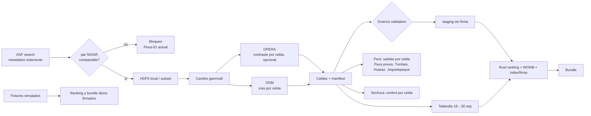

# Auditoría del pipeline de datos WOMBAT

Auditoría local del checkout actualizado, inspeccionado el 15 de noviembre de
2026. No se descargaron datos, no se consultaron servicios externos ni se
modificaron entradas del pipeline.

## Veredicto

**Amarillo.** Hay procesamiento real documentado para Piura (par previo),
Tumbes, Huaraz, Jequetepeque, Sechura (control) y Tailandia. Los primeros
cuatro AOI peruanos tienen resultados científicos guardados hasta celdas,
incluyendo OPERA y OSM en sus pares completos; Tailandia además tiene un bundle
`v1` con 600 scores, acciones y 605 bloques WONB que contienen campo de firma;
los hashes concuerdan con los 614 archivos cubiertos por `index.json`. Sin
embargo, el único resultado
integrado de Piura es anterior a las lluvias del 20 de octubre: el pipeline
oficial sigue bloqueado para un par comparable que cruce el evento. El bundle
real de Tailandia también tiene una discrepancia semántica entre el AOI del
bundle y el destinatario Piura de sus acciones, y una nota CRS incorrecta en
`cells.geojson`.

El bundle Tailandia es evidencia de ejecución integral local, no una
validación operacional: es PROVISIONAL, usa método experimental (promediado a
100 m y máscara de exclusión), la causa del cambio no está establecida y no se
comprobó aquí la firma criptográfica con el verificador oficial. El fixture
`piura-demo/v0` sigue siendo enteramente simulado. No se consultó publicación
remota.

## Matriz de AOI

| AOI | Región | Tipo de evidencia | t1/t2 | Comparable | OPERA | OSM | Celdas | Ranking/WONB | Estado |
|---|---|---|---|---|---|---|---|---|---|
| `piura-01` (pipeline oficial) | Bajo Piura, Perú | **Búsqueda consultada, no procesada como evento**. `out/piura-01/candidates.json` registra metadatos ASF y `access-preflight.json` verifica endpoint, no descarga. | Candidatos 7/19 oct PROVISIONAL y 31 oct VALIDATED. | Para evento: **no**, `selected_pair:null`, `comparable:false`, `status:"blocked"`. | No hay contexto OPERA por celda en el `out` oficial. | `roads.geojson` y metadata locales; el bbox coincide con el área de Bajo Piura. | No hay resultados de evento en `out/piura-01/`. | Ninguno oficial real. | **Bloqueado para evento**: no usar el par 19→31 oct por madurez mixta. |
| `piura-01` (previo) | Bajo Piura, Perú | **Procesado con NISAR real**, evidencia guardada en la validación por ciudades. | 7→19 oct 2026; frame 175, ascendente, modo 2005, frecuencia A, HHHH, PROVISIONAL. | **Sí**, seis chequeos verdaderos. Es línea base previa, no el evento del 20 oct. | Disponible, correlacionado con el mismo par; los OPERA 6→18 oct quedan a 1 día. | Integrado: consulta/bbox/fecha OSM y métricas por celda. | Sí, 812 celdas; README informa 29 con >25 % de cambio. | No hay ranking ni WONB de este par. | **Línea base real integrada hasta celdas**; no desbloquea el evento. |
| `piura-01` (19→31 oct exploratorio) | Bajo Piura, Perú | Cambio NISAR exploratorio mezclando madureces, reportado en README. La carpeta local con manifest y celdas no está en el conjunto versionado actual. | 19 oct PROVISIONAL → 31 oct VALIDATED. | **No**. | Serie OPERA regional no constituye corroboración de ese par exploratorio. | Insumo local, no evidencia vinculada al resultado exploratorio. | Se reporta 2,3 %/517 celdas en README de validación; no hay artefacto verificable aquí. | Ninguno. | **Candidato incompleto/no comparable**. |
| `tumbes-01` | Llanura del río Zarumilla, Tumbes, Perú | **Procesado con NISAR real como control**, con manifest, resumen, celdas, OPERA y vías por celda. | 7→19 oct 2026; frame 090, descendente, modo 4005, frecuencia A, HHHH, PROVISIONAL. | **Sí**, seis chequeos verdaderos. | Disponible, 6→18 oct, a 1 día de las escenas; tablas/celdas guardadas. | Integrado, OSM descargado 15 nov 2026, metadata con bbox y atribución. | Sí, 493 celdas; >25 % de cambio en 0 celdas según README. | No hay ranking ni WONB real. | **Control/línea base integrada hasta celdas**, no evento del 20 oct. |
| `huaraz-01` | Huaraz, Áncash, Perú | **Procesado con NISAR real**: par de referencia y par de cambio con métricas, celdas, OPERA y OSM. | Evento 5→17 oct 2026; frame 093, descendente, modo 4005, frecuencia A, HHHH, PROVISIONAL. Control: 11→23 sep. | **Sí**, seis chequeos en ambos manifests. | Disponible, 4→16 oct a 1 día; contraste local por celda. No corrobora agua nueva extensa. | Integrado, OSM 15 nov 2026 con bbox/atribución; road_cells guardados. | Sí, 240 celdas; 58,7 % del área válida subió ≥3 dB; no es evidencia de inundación. | Sin ranking/bundle. | **Evento científico real hasta celdas**, origen del cambio no determinado y limitación de relieve de sierra. |
| `jequetepeque-01` | Valle bajo del Jequetepeque, Perú | **Procesado con NISAR real**, manifest, resumen, celdas, OPERA y vías. | 24 oct→5 nov 2026; frame 092, descendente, modo 4005, frecuencia A, HHHH, VALIDATED. | **Sí**, seis chequeos verdaderos. | Disponible, 25 oct→6 nov a 1 día; datos por celda guardados. | Integrado, OSM 15 nov 2026 con bbox/atribución y road_cells. | Sí, 667 celdas; la máscara deja 149 celdas marinas con calidad insuficiente según README. | Sin ranking/bundle. | **Par comparable VALIDATED integrado hasta celdas**; cambios pequeños y ambigüedad de arrozales. |
| `sechura-01` | Desierto de Sechura, sur de Piura, Perú | **Procesado con NISAR real; control previo**, no par del evento. Manifest, resumen, celdas, bounds e imágenes están versionados. | Control 7→19 oct 2026; pista 104, frame 174, ascendente, modo 2005, frecuencia A, HHHH, PROVISIONAL. | **Sí** para el control: seis chequeos verdaderos. | En el manifest, `unavailable`. OPERA se usó como fuente de agua permanente para parámetros de exclusión según README, no como contraste de agua nueva por celda del control. | No integrado: el manifest no tiene `osm` y las celdas presentan vías 0; esto no prueba que no existan vías. | Sí, control de 870 celdas. README informa 0 celdas sobre 10 % de cambio entre 660 con calidad. | Ninguno; no es bundle. | **Control real procesado**, pero no evidencia del evento ni candidato de ranking. El evento 31 oct→12 nov sigue sin salida local; README dice que la escena del 12 nov no estaba publicada al redactarse. |
| `tailandia-01` | Llanura central, oeste de Ayutthaya, Tailandia | **Procesado con NISAR real** para control y dos ventanas de evento; el par 18→30 sep llega a bundle en `data/tailandia-01/v1`. | Control 13→25 ago; eventos 6→30 y 18→30 sep 2026. Bundle: 18→30 sep, frame 081, descendente, modo 4005, frecuencia A, HHHH, PROVISIONAL. | **Sí**, seis chequeos en el par del bundle y los otros manifests. | Disponible en el bundle, 1 día de cada NISAR; 6→30 sep tiene OPERA `unavailable`. | En bundle: roads OSM de 15 nov con consulta, atribución y hash. | 600 celdas con cambio, OPERA y vías por celda. | **Sí**: 600 Risk + 3 Action + Change + Context (605 WONB con campos de firma); 614 entradas de índice SHA-256. Los 614 hashes se comprobaron localmente, firmas criptográficas no. | **Bundle real local versionado**, no publicación remota comprobada; sus Action apuntan a GORE Piura pese a ser un AOI tailandés. |
| `piura-demo` | AOI demostrativa de Piura | **Simulado/fixture**. Los manifests declaran `data_origin:"simulated"` y granules `SIMULATED-*`. | 14→26 oct 2026 (fechas sintéticas). | El fixture declara `comparable:true` y seis checks verdaderos, pero son **metadatos simulados**, no comparabilidad científica real. | Presente, simulado. | Presente, simulado. | Sí, 16 celdas simuladas. | Sí: ranking dorado y bundle fixture con 21 bloques WONB, índice/hashes y firmas; bundle documentado como firmado para desarrollo. | **Fixture firmado, no evidencia científica real.** La existencia del fixture no desbloquea `piura-01`. |
| Regiones peruanas adicionales en `peru-fuentes-nasa` | Costa norte (barrido), Lambayeque, Áncash, Lima e Ica | NASA POWER/SMAP y análisis OPERA en archivos regionales; el README describe qué zonas se consultaron y cuáles no. No son AOI procesados por el flujo NISAR→celdas. | Series/periodos de octubre–noviembre; no hay pares NISAR por AOI en manifests locales. | No aplica/no demostrado. | Barrido costa norte y series de Bajo Piura, Sechura y Tumbes-Zarumilla guardados por separado. | No encontrado para estas regiones. | No hay celdas NISAR fusionadas. | Ninguno. | **Datos de contexto regional**; no confundir con procesamiento WOMBAT de AOI. |

El README regional (14 nov) clasifica además las fuentes: **OPERA DSWx-S1
procesado** en las series; **NASA POWER consultado**; **SMAP procesado** (50
archivos, según el README); GPM IMERG bloqueado por 403; OPERA RTC-S1 bloqueado
por EULA; HLS descartado por nubosidad; MODIS NRT sin procesar y ninguna
observación SWOT encontrada. Son estados de esa exploración regional, no
entradas integradas en un ranking WOMBAT.

El estado **oficial** de evento Piura no cambió: `data-pipeline/out/piura-01/`
sigue con candidatos/preflight y `selected_pair:null`. Las salidas nuevas en
`validacion/resultados/peru-fuentes-nasa/ciudades/piura-01/` procesan el
control 7→19 oct, PROVISIONAL→PROVISIONAL, no el evento. El intento 19→31 oct
no pasa comparabilidad, porque combina PROVISIONAL con VALIDATED.

## Qué fuentes se fusionan realmente

- **Tailandia, evento 18→30 sep:** NISAR (frame 081), OPERA (granules/fechas a
  1 día) y OSM están fusionados en las mismas 600 celdas. La evidencia inicial
  está en `validacion/resultados/tailandia-01/evento-18sep-30sep/`; ahora
  `data/tailandia-01/v1/` contiene métricas, configuración, vías, overlays y
  605 bloques WONB (Change, Context, 600 Risk y 3 Action). Rust produjo
  ranking/acciones. `index.json` referencia 614 archivos y se comprobaron
  localmente los 614 SHA-256. No se ejecutó el verificador criptográfico:
  `wombat` no está en PATH y faltan dependencias `node_modules` del verificador
  JS. El bundle es PROVISIONAL y su README limita el uso a priorización.
- **Tailandia, control y evento 6→30 sep:** NISAR real y celdas/resultados de
  cambio, pero sin fusión completa OPERA/OSM. El resultado 6→30 tiene un
  análisis OPERA complementario fuera de la ventana temporal y no equivale al
  contraste dentro de regla del par 18→30.
- **Piura previo 7→19 oct:** NISAR comparable, OPERA 6→18 oct y OSM están
  fusionados en 812 celdas bajo
  `validacion/resultados/peru-fuentes-nasa/ciudades/piura-01/`. Es línea base
  previa, no el evento del 20 oct; no hay ranking Rust ni bundle.
- **Tumbes 7→19 oct:** el control real combina NISAR, OPERA 6→18 oct y OSM en
  493 celdas por AOI. No es el evento ni tiene ranking/bundle.
- **Huaraz 5→17 oct:** integra NISAR, OPERA y OSM por celda en 240 celdas.
  Observa principalmente un aumento de retrodispersión (+3,33 dB mediana;
  58,7 % del área válida sube ≥3 dB); OPERA no corrobora agua nueva extensa.
  La causa no está establecida.
- **Jequetepeque 24 oct→5 nov:** combina NISAR VALIDATED, OPERA 25 oct→6 nov y
  OSM en 667 celdas; el README describe 5 celdas corroboradas. Sin ranking ni
  bundle.
- **Sechura control 7→19 oct:** NISAR real→cambio→870 celdas sí está guardado.
  OPERA aparece `unavailable` en el manifest/celdas (aunque se usó agua OPERA
  como máscara según README); OSM no está integrado y longitudes 0 no prueban
  ausencia de vías. No hay evento NISAR por celda.
- **`piura-demo`:** manifest, celdas, `roads.geojson`, OPERA, configuración,
  ranking y WONB están unidos dentro del bundle, pero toda esa evidencia es
  sintética.
- **Resto de Perú:** OPERA, NASA POWER, SMAP y gamma0 medio de NISAR están
  almacenados como series/tablas regionales separadas. Tener los mismos nombres
  geográficos no las convierte en un producto de fusión por celda.

## Qué NO está fusionado o no está demostrado

- **Falta de dato/par:** Piura-01 no tiene un par de madurez igual que cruce el
  evento. Los pares PROVISIONAL 7→19 oct son ambos anteriores al 20 oct; el
  19→31 oct mezcla PROVISIONAL con VALIDATED. El resultado de búsqueda dice
  `blocked`, `selected_pair:null` y “No science outputs produced”.
- **Dato simulado:** todos los `SIMULATED-*`, `data_origin:"simulated"`, celdas
  y resultados de `piura-demo` son para fixtures. `comparable:true` en esos
  manifests no autentica adquisición real.
- **Evento Piura no procesado como evidencia comparable:** el par 7→19 oct es
  válido y está fusionado por celda, pero es una línea base anterior a las
  lluvias. El pipeline oficial sigue sin pareja comparable que cruce el evento;
  `data-pipeline/out/piura-01/` no contiene el evento procesado.
- **Persistencia incompleta para reproducibilidad:** manifests, summaries,
  celdas, OPERA/road cells y overlays reducidos de los AOI recientes sí están
  versionados, pero no aparecen los HDF5/GeoTIFF intermedios que permitan
  rehacer el cálculo.
- **Fusión parcial por AOI:** Piura previo, Tumbes, Huaraz, Jequetepeque y
  Tailandia 18→30 tienen OPERA/OSM por celda; Sechura control y los pares base
  de Tailandia no. Las series regionales OPERA continúan separadas.
- **Bundle real local sí existe:** `data/tailandia-01/v1/` contiene
  `index.json`, 605 bloques con campo `signature`, configuración y ranking
  generado desde un manifest `nisar_real`; `latest.json` apunta a `v1/`. Los
  614 hashes concuerdan con el índice. Eso verifica integridad de archivo
  contra el índice, no validez criptográfica ni confianza del emisor. El
  fixture `piura-demo/v0` es un bundle distinto y simulado. No se revisó
  publicación remota.
- **Método experimental:** Tailandia usa promediado a 100 m y máscara de
  exclusión; su README advierte que son cambios de método no aprobados aún.
  Esta salida valida una prueba de método, no el método contractual de
  producción sin más revisión.

## Riesgos de integridad o mezcla entre regiones

1. **Mezcla semántica confirmada en las acciones del bundle Tailandia.** El
   manifest y los `cell_id` ubican los datos en `tailandia-01` (Ayutthaya),
   pero los topics WONB usan `wombat/pe/piura/tailandia-01/...` y los tres
   bloques `action` declaran `audience: "GORE Piura risk analyst"`. Esto no
   altera los píxeles/celdas, pero puede presentar o enrutar una acción de
   Tailandia como si fuera para Piura. No usarlo como destino operativo Piura
   sin resolver el destinatario/topic y regenerar/reverificar el bundle.
2. **No encontré mezcla geométrica en los resultados por ciudad.** Los
   identificadores/bbox y manifests de Tailandia, Huaraz, Tumbes, Jequetepeque,
   Sechura y Piura corresponden a sus AOI; las consultas OSM tienen bbox de
   esos lugares y los manifests enlazan granules OPERA al par temporal. Es
   evidencia observada, no garantía general del código.
3. **La vinculación espacial de insumos externos depende parcialmente de la
   ruta.** `validacion/06_cells.py` deriva `inputs/<aoi_id>` del manifest y
   comprueba que el ID de la grilla coincida, un buen control contra un error
   obvio. Sin embargo, los consumidores de vías comprueban formato/CRS y
   metadatos OSM, pero no prueban una igualdad de bbox/identidad geográfica
   entre vías, OPERA y AOI. Un `--inputs` o archivo `--roads` equivocado podría
   pasar validaciones de formato; para un insumo distante puede terminar en
   ceros y parecer ausencia de exposición. Los validadores que comprueban
   `cell_id` no autentican que el contenido espacial sea del AOI correcto.
4. **La vinculación OPERA sí tiene controles temporales y de par, pero no una
   llave AOI independiente.** El consumidor oficial revisa producto,
   granules NISAR T1/T2, umbral y desfase de hasta seis días. Se debe conservar
   además un bbox/ID de AOI del producto de origen y rechazar un conjunto de
   celdas desconocidas o de otra región, en vez de asumir que el nombre de
   archivo basta.
5. **Piura tiene dos identidades que se parecen:** `piura-01` es el AOI
   científico de Bajo Piura; `piura-demo` es un fixture pequeño simulado.
   Evitar presentar los scores, carreteras o fechas del demo como resultados
   del AOI `piura-01`.
6. **Salidas generadas no versionadas:** `data-pipeline/out/` está ignorado por
   Git. Los candidatos y preflight de Piura existen localmente, pero no
   aparecen en `git ls-files`; no son evidencia reproducible para otro
   checkout salvo que se archiven con procedencia adecuada.
7. **CRS descriptivo incorrecto en el bundle Tailandia:** su
   `manifest.json` declara cálculo en `EPSG:32647`, pero `cells.geojson` dice en
   `crs_note` que se calculó en `EPSG:32717`. Las geometrías están en WGS84 y
   sus coordenadas concuerdan con Tailandia; es metadato contradictorio, no
   prueba de desplazamiento geométrico. El README de ciudades indica que los
   artefactos nuevos corrigen esa nota en otros AOI, mientras el bundle
   Tailandia conserva el valor antiguo.
8. **Configuraciones duplicadas:** están `config/risk-config.json` y
   `data-pipeline/config/risk-config.json`, hoy con los mismos valores
   principales/version `risk-config/0.1`. La duplicación permite divergencia
   futura. Además, el resultado Tailandia guarda versión, no hash/copia del
   archivo efectivamente usado.
9. **Documentación desactualizada/inconsistente:** `docs/architecture.md`
   afirma que el pipeline aún no tiene scripts; sí los hay en el checkout.
   `data-pipeline/README.md` dice que faltan vías OSM para Piura aunque existen
   esas vías y metadata. Los manifests/celdas nuevos corrigen parcialmente la
   impresión de que no hay procesamiento de Piura/Tumbes/Huaraz/Jequetepeque,
   pero el resultado exploratorio 19→31 oct de Piura no tiene artefactos
   verificables. Distinguir baseline comparable, exploratorio mixto y evento
   comparable.

## Diagrama de flujo



El diagrama es el flujo implementado/observado, no una afirmación de ejecución
continua. La búsqueda ASF produce metadatos y no descarga; el subset requiere
archivos locales. OPERA lo calcula/entrega un productor externo al consumidor
NISAR; el pipeline oficial solo consume el contexto ya calculado. La ejecución
comprobada llega a celdas en los AOI peruanos listados y a un bundle real local
de Tailandia; no se encontró ranking/bundle para los AOI peruanos recientes.
Piura evento permanece bloqueado antes del procesamiento.

## Próximas tareas priorizadas

- **P0 — Gustavo, pipeline científico / NISAR-OPERA-OSM:** resolver un par
  comparable de Piura que cruce el evento; sostener el bloqueo mientras se
  mantenga `selected_pair:null` y evitar presentar 19→31 oct como comparable.
  Conservar la línea base 7→19 por separado. Revisar también el topic/audience
  y la nota CRS del bundle Tailandia antes de cualquier reuso.
- **P1 — Favio, contratos/Rust/ranking/WONB:** verificar criptográficamente el
  bundle Tailandia con el verificador oficial, corregir/reemitir las acciones
  con destino coherente y fijar hash/copia de la configuración. Mantener el
  ranking y bundle de AOI peruanos detrás del gate científico; añadir o
  confirmar validación espacial independiente de AOI para OSM/OPERA.
- **P1 — Gustavo, pipeline científico:** conservar fuentes intermedias o
  registrar su ubicación reproducible para los resultados por ciudad; explicar
  la causa del cambio de Huaraz y la ambigüedad de arrozales de Jequetepeque.
- **P2 — Jayo, gateway/publicación:** no publicar como operativo el bundle
  Tailandia hasta resolver su semántica y verificación de firma. La auditoría
  solo confirma su presencia en el checkout, no una publicación remota.
- **P2 — Mireya, dashboard/visualización:** mostrar `simulated`, `control`,
  `exploratory`, `baseline` y `real` de forma diferenciada y derivada de
  manifest/provenance; mostrar madurez/par y bloquear fixture como Piura
  operativo.

## Comandos seguros de verificación

Estos comandos son locales; no hacen login Earthdata ni llaman APIs. Los
comandos Python deben ejecutarse solo si las dependencias ya existen. Si falta
una, detenerse y reportarla: no instalarla.

```bash
# Estado y archivos locales/versionados
git status --short --branch
git ls-files data-pipeline/inputs data-pipeline/out data-pipeline/validacion/resultados fixtures contracts/v1/fixtures/bundle data
find data-pipeline/inputs data-pipeline/out data-pipeline/validacion/resultados fixtures contracts/v1/fixtures/bundle -type f | sort

# Inspección manual de procedencia/comparabilidad; no editar los JSON
rg -n '"data_origin"|"comparable"|"comparable_checks"|"maturity"|"frame"|"orbit_direction"|"mode"|"frequency"|"polarization"|"selected_pair"|"status"' \
  data-pipeline/out/piura-01 data-pipeline/validacion/resultados -g 'manifest.json' -g 'candidates.json'

# Pruebas que usan fixtures temporales y no descargan productos
python -B -m pytest -c data-pipeline/pytest.ini -p no:cacheprovider -q
python -B -m pytest data-pipeline/validacion/tests -p no:cacheprovider -q

# Validar solo lectura la presencia/completitud de la evidencia científica local
python -B data-pipeline/nisar/assemble.py --validate-only --source data-pipeline/out/piura-01

# Verificar el fixture ya local (requiere dependencias Python ya instaladas)
python -B contracts/v1/tools/verify_bundle.py contracts/v1/fixtures/bundle/piura-demo/v0

# Comprobar hashes locales del bundle Tailandia contra su índice (Node.js)
node -e 'const fs=require("fs"),path=require("path"),crypto=require("crypto"); const root="data/tailandia-01/v1", base=path.resolve(root), index=JSON.parse(fs.readFileSync(path.join(base,"index.json"))); if(!Array.isArray(index.files))throw Error("index.files no es una lista"); let bad=0; for(const item of index.files){if(typeof item.path!=="string"||path.isAbsolute(item.path))throw Error("ruta inválida en índice"); const file=path.resolve(base,item.path); if(!file.startsWith(base+path.sep))throw Error("ruta fuera del bundle"); const actual=crypto.createHash("sha256").update(fs.readFileSync(file)).digest("hex"); if(actual!==item.sha256){console.error("HASH MISMATCH",item.path);bad++;}} if(bad)process.exit(1); console.log(index.files.length,"hashes OK");'
```

En esta auditoría se inspeccionaron archivos/metadata locales; no se ejecutaron
pruebas Python ni verificadores que puedan requerir dependencias. Se comprobó
que el informe no tenga espacios finales; no se ejecutó ningún comando de
pipeline que escriba resultados.

## Archivos inspeccionados

Se inventariaron los archivos bajo `data-pipeline/`, `data-pipeline/inputs/`,
`data-pipeline/out/`, `data-pipeline/validacion/`,
`data-pipeline/validacion/resultados/`, `fixtures/`,
`contracts/v1/fixtures/`, `out/` y `docs/`. La lectura detallada incluyó:

- Documentación: `data-pipeline/README.md`,
  `data-pipeline/validacion/README.md`,
  `data-pipeline/validacion/resultados/peru-fuentes-nasa/README.md`,
  `data-pipeline/validacion/resultados/peru-fuentes-nasa/sechura-01/README.md`,
  `data-pipeline/validacion/resultados/tailandia-01/README.md`,
  `docs/architecture.md`, `docs/demo-runbook.md`, `docs/wonb-spec.md` y
  `contracts/v1/README.md`.
- Piura actual: `data-pipeline/inputs/piura-01/aoi.geojson`,
  `grid.geojson`, `roads.geojson`, `osm-metadata.json`,
  `data-pipeline/out/piura-01/candidates.json` y `access-preflight.json`,
  `data-pipeline/config/risk-config.json`.
- Manifests y resultados: manifests/candidates/change summaries de Tailandia
  (13→25 ago, 6→30 sep, 18→30 sep), `cells.geojson`,
  `opera_cells.json`; `sechura-01/candidates.json`, manifest, summary,
  `cells.geojson` y `exclude.json`; series OPERA de Bajo Piura,
  Tumbes-Zarumilla y Sechura; `nisar-gamma0-medio.json` y
  `opera/barrido-costa-norte.json`; manifests, resúmenes, celdas y salidas
  por ciudad para `piura-01/previo-07oct-19oct`, `tumbes-01`,
  `huaraz-01` y `jequetepeque-01`.
- Bundle de Tailandia: `data/tailandia-01/README.md`,
  `data/tailandia-01/latest.json`, y de `data/tailandia-01/v1/`,
  `manifest.json`, `index.json`, `cells.geojson`, configuración, overlays,
  artefactos de ranking y los bloques WONB `action`, `change`, `context` y
  `risk`. Se compararon localmente los hashes indexados; no se validó firma.
- Código: `data-pipeline/nisar/search.py`, `subset.py`, `change.py`,
  `integration.py`, `cells.py`, `assemble.py`;
  `data-pipeline/validacion/validate_opera.py`, `05_roads.py`, `06_cells.py`,
  `wombat_nisar/assemble.py` y `wombat_nisar/roads.py`.
- Fixtures/configuración: `fixtures/manifest.json`,
  `fixtures/piura-demo/manifest.json`, `fixtures/cells.geojson`,
  `contracts/v1/fixtures/bundle/piura-demo/v0/manifest.json`,
  `index.json`, `cells.geojson`, `risk-config.json`,
  `contracts/v1/fixtures/expected/ranking.json`,
  `config/risk-config.json` y `.gitignore`.

Los archivos HDF5/GeoTIFF intermedios de los experimentos por ciudad no
aparecen en el inventario versionado inspeccionado. Los resultados persistidos
en `validacion/resultados/` y el bundle local Tailandia son las evidencias
revisadas; el índice del bundle no equivale a una verificación criptográfica.

## Archivo creado

Únicamente se creó/actualizó `docs/DATA_PIPELINE_AUDIT.md`. No se modificaron
código, datos, configuración ni manifests; no se hizo commit ni push.
